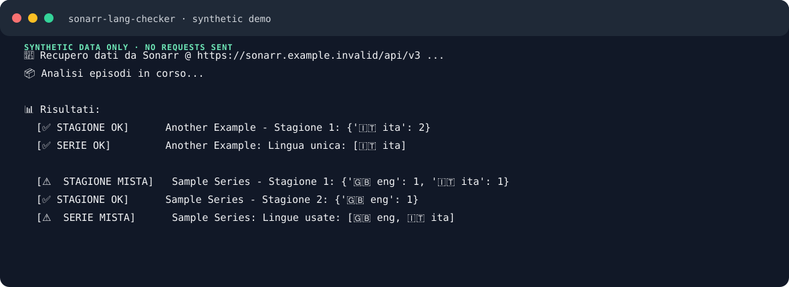

# sonarr-lang-checker

[English](README.en.md) · Italiano

[](https://github.com/alsd4git/sonarr-lang-checker/actions/workflows/tests.yml)
[](LICENSE)

Individua coperture audio incoerenti in una libreria Sonarr v4. La CLI segnala stagioni con lingue miste, confronta le stagioni di una serie e verifica se gli episodi contengono un insieme di lingue desiderate.



La demo usa serie, episodi e tracce audio di esempio con il codice reale di analisi e di output della CLI. Non contatta Sonarr. Rigenera l'immagine con `uv run python scripts/demo.py`.

È richiesto Sonarr v4. Le versioni precedenti non sono supportate.

## Requisiti

- Python 3.10 o successivo
- [uv](https://docs.astral.sh/uv/)
- URL e API key di Sonarr v4

## Installazione

Installa dal branch predefinito su GitHub:

```bash
uv tool install git+https://github.com/alsd4git/sonarr-lang-checker.git
sonarr-lang-checker --help
```

Per una singola esecuzione:

```bash
uvx --from git+https://github.com/alsd4git/sonarr-lang-checker.git sonarr-lang-checker --help
```

Non sono ancora state pubblicate release del pacchetto. Quando saranno disponibili,
aggiungi il tag alla URL Git, per esempio `@v0.1.0`, per scegliere quella versione.
Il workflow di release produce wheel e distribuzione sorgente. Prima di creare un tag,
registra la versione corrispondente in [CHANGELOG.md](CHANGELOG.md).

## Configurazione

Crea `.env` nella directory da cui esegui il comando e imposta questi valori:

```dotenv
API_KEY=inserisci-la-tua-api-key
SONARR_URL=https://sonarr.example.org
```

Mantieni privato il file `.env`. Una API key passata come argomento può essere salvata nella cronologia della shell o comparire nella lista dei processi.

## Utilizzo

```bash
# Analisi standard
sonarr-lang-checker

# Stampa JSON su stdout
sonarr-lang-checker --json

# Salva risultati strutturati, inclusi i metadati degli errori parziali
sonarr-lang-checker --structured-json --output report.json

# Segnala la copertura italiana e inglese mancante o parziale
sonarr-lang-checker --wanted-langs ita,eng

# Include le stagioni che soddisfano tutte le lingue richieste
sonarr-lang-checker --wanted-langs ita,eng --show-all

# Riduce le richieste concorrenti verso Sonarr
sonarr-lang-checker --workers 2
```

Usa `sonarr-lang-checker --help` per l'elenco completo delle opzioni.

### Opzioni principali

| Opzione | Scopo |
| --- | --- |
| `--json` | Stampa su stdout il formato JSON originale. |
| `--structured-json` | Include i metadati `results`, `failures` e `complete`. |
| `--output PERCORSO` | Scrive l'output JSON in un file. |
| `--wanted-langs ELENCO` | Verifica un elenco separato da virgole, per esempio `ita,eng`. |
| `--show-all` | Include le stagioni monolingua o con copertura completa. |
| `--ignore-unknown` | Esclude le tracce sconosciute dal confronto delle lingue. |
| `--ignore-anime` | Ignora le serie con tipo Anime in Sonarr. |
| `--workers N` | Limita le richieste concorrenti. Il valore predefinito è 4, il massimo è 16. |
| `--timeout SECONDI` | Imposta il timeout di lettura HTTP. |

I codici lingua vengono normalizzati prima del confronto. L'ordine delle tracce non conta, gli alias comuni vengono unificati e le tracce sconosciute usano `und`.

## Codici di uscita

| Codice | Significato |
| --- | --- |
| `0` | L'analisi è stata completata. |
| `1` | Un errore fatale di configurazione o richiesta ha impedito l'analisi. |
| `2` | Sono stati prodotti risultati parziali perché non è stato possibile recuperare una o più serie. |

Gli errori e il riepilogo dei risultati parziali vengono scritti su stderr, così il JSON su stdout resta leggibile dalle applicazioni.

## Sviluppo

```bash
git clone https://github.com/alsd4git/sonarr-lang-checker.git
cd sonarr-lang-checker
uv sync --locked --dev
uv run sonarr-lang-checker --help
uv run ruff format --check .
uv run ruff check .
uv run pytest -q
uv build
```

`python main.py` resta supportato nelle checkout sorgenti.

GitHub Actions esegue questi controlli su Linux, macOS e Windows con la versione Python minima e quella più recente supportate.

## Licenza

Distribuito con licenza [MIT](LICENSE).
